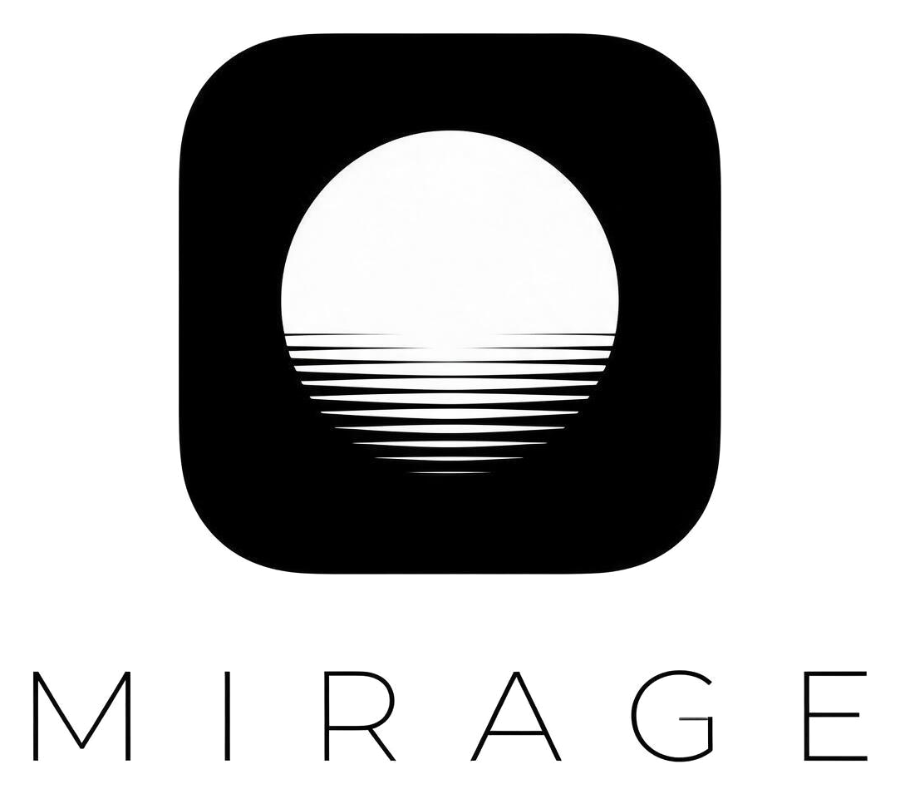

<p align="center">
  <picture>
    <source media="(prefers-color-scheme: dark)" srcset="assets/logo-dark.png" />
    
  </picture>
</p>

<p align="center"><b>A live wallpaper you can actually use.</b></p>

Mirage sits behind your desktop icons and turns the desktop into a home screen: live 3D wallpapers,
sticky notes, to-dos, your GitHub graph, weather, music, a dock, Spotlight search and a local AI
assistant. No app window, it just becomes your desktop.

**Setup guides:** [Windows](docs/SETUP-WINDOWS.md) · [Linux](docs/SETUP-LINUX.md)

## Quick start

Needs **Windows 10/11** or **Linux** (see below), **Git** and **Node 22+**. One line puts it on your desktop.

**Windows** — open PowerShell and paste:

```powershell
irm https://raw.githubusercontent.com/ADT1123/Mirage-by-BBC/main/scripts/install.ps1 | iex
```

**Linux** — open a terminal and paste:

```bash
curl -fsSL https://raw.githubusercontent.com/ADT1123/Mirage-by-BBC/main/scripts/install.sh | bash
```

The script checks Git and Node, downloads Mirage to your home folder, installs it, turns on the `bro`
command and starts it. It installs nothing else: if Git or Node 22+ is missing it tells you where to
get it and stops. Options: `-Dir <path>` / `--dir <path>` to pick the folder, `-NoStart` / `--no-start`
to install without starting.

### If you'd rather not pipe a script

Same thing by hand:

```bash
git clone https://github.com/ADT1123/Mirage-by-BBC.git
cd Mirage-by-BBC
npm install
npm start          # puts it on your desktop
```

`npm run stop` brings your normal wallpaper back. Run `npm link` once to use the `bro` command anywhere.

### Linux

Works on mainstream desktops: **Ubuntu 24.04 / 26.04, Fedora, Linux Mint, Pop!_OS** (GNOME), and KDE Plasma.
Same steps (`npm install`, `npm start`). Nothing extra is installed; Mirage uses the tools your distro already has.

```bash
npm run cli -- doctor      # shows which features work on this machine
npm run cli -- shortcuts   # Wayland (Ubuntu 26.04): adds Alt+W and Ctrl+Space as GNOME shortcuts
```

Good to know:
- On Wayland sessions Mirage runs through XWayland automatically; you don't need to change anything.
- If Ubuntu's desktop icons cover the wallpaper, turn off "Desktop Icons" in the Extensions app.
- Screen time in Wrapped and "pause when an app is maximized" are Windows-only for now.

## Shortcuts

| Key | Does |
| --- | --- |
| `Alt+W` | Edit mode: drag, resize and restyle widgets |
| `Ctrl+Space` | Spotlight: apps, files, settings, math, web, AI |
| Click on the wallpaper | Notes, to-dos, Wi-Fi (Control Center), dock, music all work |
| `•••` on a widget | Edit that widget (style, color, size, options) |
| `Esc` | Close the open panel, then leave edit mode |

## Features

- **89 wallpapers in 10 packs**, most of them live 3D that react to your mouse:
  - **Glass & Chrome**: liquid glass and molten metal, lit like a studio
  - **Liquid**: chrome blobs, a soap bubble, ink in water and a koi pond
  - **Silk**: satin folds that slowly breathe
  - **Landscapes**: dunes, northern lights and a live sky
  - **Astronomy**: the Sun, every planet, tonight's Moon, the real Earth and Earthrise, from real maps
  - **Clay**, **Neon & Tech**, **Color** (gradients in any colors), **Emoji** and the original **Classics**
- **Light on any laptop**: wallpapers idle at a low frame rate, speed up while you interact, and never take more than a small share of the GPU
- **Wallpaper blur** in Control Center, for a calmer desktop behind your widgets
- **17 themes**, each with light and dark: Aurora, Midnight, Terminal, Cartoon, Blast, Weather, Paper, Synthwave, Zen, Retro, Bhakti, Pastel, Ocean, Sakura, Orbit, Forest, Astronomy
- **Widgets**: clock (8 styles), GitHub contributions, sticky notes, to-dos, weather (click for full forecast), calendar, countdown, quote, Gita verse, system stats, Smart Stack, Now Playing, photos, memories, dock. Every widget's style, color, font and size can be changed
- **Set up in four steps** the first time you start it: pick a look, pick your widgets, say who you are, choose how hard it works
- **Share your setup**: `bro export` turns your whole desktop into one code. A friend runs `bro import <code>` and theirs looks the same. Your name, city, notes and to-dos never travel with it
- **Your own photo, gently alive**: a photo background drifts slowly and leans towards the pointer
- **Kind to a battery**: unplugged, wallpapers ease off; under 20% they stop animating until you plug in. Control Center shows exactly what the wallpaper is costing right now
- **Updates itself**: a small "Update ready" pill appears when there's a new version; one click installs it
- **Now Playing**: full-screen player with live artwork backdrop, visualizer and recently played (`H`)
- **Spotlight quick actions**: `note buy milk`, `todo call mom`, `ask plan my evening`
- **Local AI**: answers questions and organizes your to-dos, notes and countdowns (see below)
- **Weekly Wrapped**: top songs, commits, active time and most-used apps, shareable as a PNG
- **Live weather on the desktop**: rain or snow over any theme when it's really happening
- **Desktop pet**: a cat or bird that walks along the bottom of your screen

## Local AI (optional)

Runs fully on your PC with [Ollama](https://ollama.com). Nothing is sent online.

```bash
ollama pull llama3.1:8b      # one-time download (~5 GB)
```

Then press `Ctrl+Space` and type `ask sort my to-dos by urgency`, or use `bro ai <question>`.
Switch models with `bro ai models` and `bro ai model <name>`.

## CLI

Run `bro` for the interactive shell (type `/` for the menu), or one command at a time:

```bash
bro walls liquid            # list wallpapers (all 89, or one pack)
bro wall koi pond           # switch wallpaper by name or id
bro settings                # every setting and its current value
bro set blur 30             # change any setting (bro set quality balanced, bro set clock 24 ...)
bro add weather             # add or remove widgets (bro remove weather)
bro export                   # pack your whole look into one code
bro import <code>            # wear a setup a friend sent you
bro theme zen                # switch theme (bro themes lists them)
bro note ship it --pink     # pin a sticky note
bro todo record voiceover   # add a task; bro done 1 ticks it off
bro city Mumbai             # weather location
bro appearance dark         # light | dark | auto
bro pet bird                # cat | bird | off
bro fx snow                 # desktop weather: auto | off | rain | snow | storm
bro wrapped                 # this week's summary
bro autostart on            # start when you sign in
bro help                    # everything else
```

## Settings and data

Everything is in `~/.mirage/` (`config.json`, song history, screen time). It never leaves your PC,
except weather, quotes and GitHub contributions, which are fetched from public APIs.

## Updating

Mirage checks GitHub every few minutes. When there's a new version, an **Update ready** pill shows
at the top of the desktop; click **Install** and it restarts on the new version. You can also run
`git pull` yourself.

Publishing an update: edit `release.json` (version, title, a few short notes) and push. That text is
what people see in the update notice; a push that leaves it alone shows "Bug fixes and improvements".

## Troubleshooting

- **Wallpaper is blank:** run `bro restart`.
- **Commit graph is empty:** `bro github <your-username>` or `bro repo scan <projects-folder>`.
- **AI says Ollama is missing:** install it from ollama.com, then `ollama pull llama3.1:8b`.
- More fixes for each system: [Windows guide](docs/SETUP-WINDOWS.md#troubleshooting), [Linux guide](docs/SETUP-LINUX.md#troubleshooting).

Logo files are built from `assets/logo-source.png` with `npm run icon`.

## Credits

Planet, Moon, Sun and star maps: [Solar System Scope](https://www.solarsystemscope.com/textures/), licensed [CC BY 4.0](https://creativecommons.org/licenses/by/4.0/) (based on NASA imagery). The 2k set ships in `assets/planets`; the 8k versions are downloaded once from Wikimedia Commons when High quality or the close-up over your city needs them.

## License

MIT
